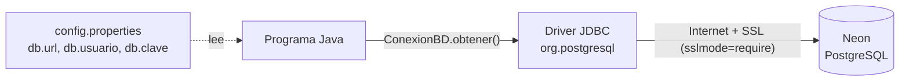
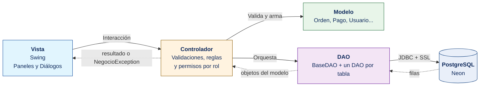
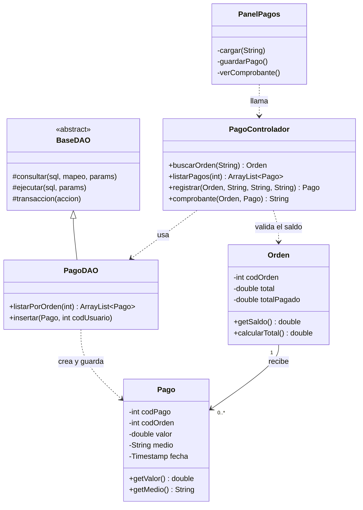
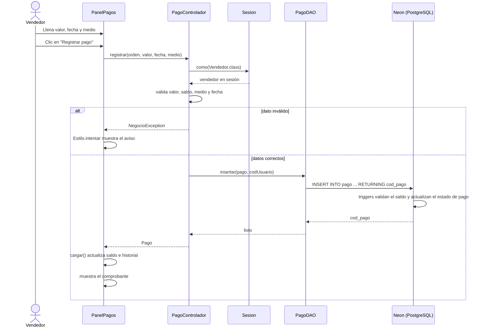
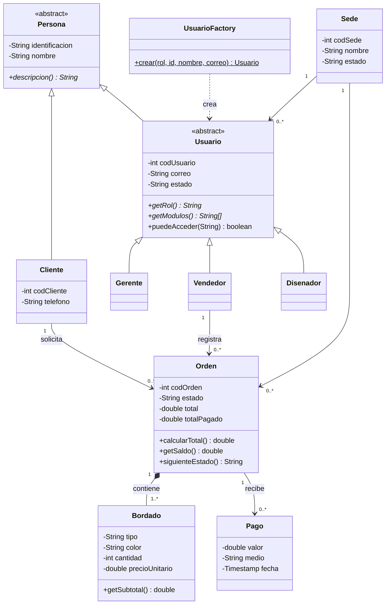
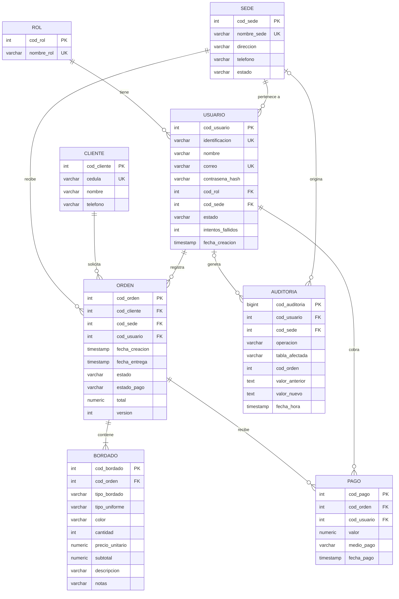
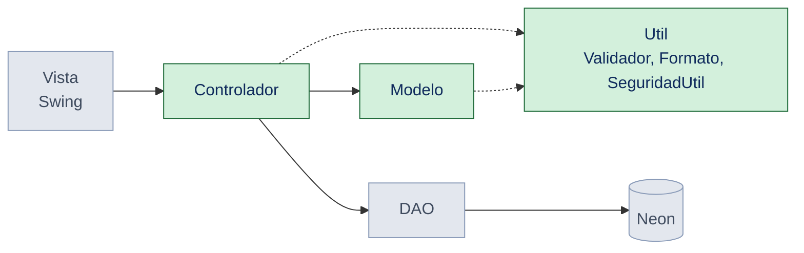

# Sistema Integral de Gestión de Pedidos para Bordados J.M.Y.M.

**Grupo 411**

| Integrantes |
|---|
| Andrés Julián Contreras |
| Samir Correa |
| Sebastián Lasso |
| Germán Darío Bolaños |

Programa de escritorio en **Java 21 + Swing**, con **Maven**, arquitectura **MVC** y base de datos
**PostgreSQL en Neon** (administrada con DBeaver). Librerías: el driver `postgresql` y, solo para las pruebas, **JUnit 5**.

## Contenido
1. [Qué necesitas instalar](#1-qué-necesitas-instalar)
2. [Crear la base de datos en Neon](#2-crear-la-base-de-datos-en-neon)
3. [Configurar la conexión con Neon](#3-configurar-la-conexión-con-neon)
4. [Ejecutar](#4-ejecutar)
5. [Arquitectura MVC](#5-arquitectura-mvc)
6. [Estructura del proyecto](#6-estructura-del-proyecto)
7. [Diagramas de referencia](#7-diagramas-de-referencia)
8. [Modelo entidad-relación (MER)](#8-modelo-entidad-relación-mer)
9. [Maven: ciclos de vida y pom.xml](#9-maven-ciclos-de-vida-y-pomxml)
10. [Pruebas unitarias con JUnit](#10-pruebas-unitarias-con-junit)
11. [Cuentas de prueba](#11-cuentas-de-prueba-contraseña-de-todas-jmym2026)
12. [Dónde está cada concepto de POO](#12-dónde-está-cada-concepto-de-poo)
13. [Reglas importantes](#13-reglas-importantes)
14. [Referencias de estilo visual](#14-referencias-de-estilo-visual)
15. [Trabajo en equipo](#15-trabajo-en-equipo)

## 1. Qué necesitas instalar
JDK 21 • Maven 3.9 o superior • DBeaver • Una cuenta gratuita en https://neon.tech

## 2. Crear la base de datos en Neon
1. En Neon crea un proyecto y copia los datos de conexión (botón **Connect**).
2. En DBeaver: *Nueva conexión → PostgreSQL* con host, base (`neondb`), usuario y contraseña (SSL: `require`).
3. Abre `sql/bordados_jmym_postgresql.sql` y ejecútalo como script (**Alt + X**).
   Crea tablas, triggers, funciones, vistas, roles, las 3 sedes, las **7 cuentas** y **30 clientes de prueba** con sus órdenes.
   > Si ya tenías la base creada con una versión anterior, ejecuta solo `sql/migracion_v2_2_entrega_pagada.sql`
   > (incluye la regla de entrega, las cuentas de las sedes y los 30 clientes; se puede ejecutar varias veces sin duplicar nada).

## 3. Configurar la conexión con Neon
La base de datos **no está en el computador**: vive en Neon (PostgreSQL en la nube) y el programa se conecta por internet con **JDBC** y SSL.
Edita `src/main/resources/config.properties` (o deja una copia junto al `.jar`). El repositorio trae `config.properties.ejemplo` como plantilla;
el archivo real está en `.gitignore` para **no subir tu clave a GitHub** (cada integrante crea el suyo):

    cp src/main/resources/config.properties.ejemplo src/main/resources/config.properties

Luego edita los datos:

    db.url=jdbc:postgresql://ep-xxxx.us-east-2.aws.neon.tech/neondb?sslmode=require
    db.usuario=tu_usuario
    db.clave=tu_clave



- `ConexionBD.obtener()` abre **una sola conexión compartida** con `DriverManager.getConnection(...)` y la reabre si ya no es válida.
- Las variables de entorno `DB_URL`, `DB_USER` y `DB_PASSWORD` tienen prioridad sobre el archivo.
- Todos los DAO heredan de `BaseDAO`, que usa `PreparedStatement` (evita inyección SQL) y agrupa operaciones en transacciones.

> La primera conexión puede tardar unos segundos: Neon "duerme" la base cuando no se usa.

## 4. Ejecutar
    mvn compile exec:java            # ejecutar directamente
    mvn clean package                # compilar, probar y crear el .jar
    java -jar target/bordados-jmym-1.0.jar
    mvn test                         # solo las pruebas unitarias

## 5. Arquitectura MVC
El patrón **MVC (Modelo-Vista-Controlador)** separa la aplicación en capas, para que la interfaz nunca hable directamente con la base de datos:



### Responsabilidades por capa
| Capa | Paquete | Responsabilidad | Ejemplo |
|---|---|---|---|
| **Vista** | `com.jmym.vista` | Interfaz con el usuario (Swing): muestra datos y captura la entrada | `PanelPagos` — formulario y tabla de pagos |
| **Controlador** | `com.jmym.controlador` | Orquesta el flujo entre Vista y DAO; valida y aplica reglas de negocio y permisos por rol | `PagoControlador` — valida que el pago no supere el saldo |
| **Modelo** | `com.jmym.modelo` | Representación de los datos, con sus validaciones | `Pago`, `Orden` — atributos y `getSaldo()` |
| **DAO** | `com.jmym.dao` | Persistencia en la base de datos (SQL con JDBC) | `PagoDAO` — `insertar`, `listarPorOrden` |
| Conexión | `com.jmym.conexion` | Conexión a Neon | `ConexionBD` |
| Utilidades | `com.jmym.util` | Apoyo común | `Validador`, `Formato`, `SeguridadUtil`, `NegocioException` |

Este proyecto **no tiene una capa de servicio aparte**: las reglas de negocio están en los controladores.

**Flujo:** Vista → Controlador → DAO → Base de datos. Los errores se lanzan como `NegocioException` y la vista los muestra en un aviso con `Estilo.intentar(...)`.

## 6. Estructura del proyecto
Maven funciona por **convención sobre configuración**: si se respetan estas carpetas, no hay que configurar nada más.

```
bordados-jmym/
├── pom.xml                              # descriptor de Maven (dependencias, plugins, Java 21)
├── README.md
├── CONTRIBUTING.md                      # cómo trabajar en equipo (ramas, commits, Pull Requests)
├── .github/workflows/ci.yml             # CI: compila y corre mvn test en cada push y Pull Request
├── sql/                                 # scripts de la base de datos
├── docs/                                # diagramas (.mmd + .png) y documentos del equipo (.md)
└── src/
    ├── main/
    │   ├── java/
    │   │   └── com/
    │   │       └── jmym/
    │   │           ├── App.java                      # Punto de entrada (main)
    │   │           ├── conexion/                     # Conexión a Neon
    │   │           │   └── ConexionBD.java
    │   │           ├── modelo/                       # Entidades
    │   │           │   ├── Persona.java  Cliente.java
    │   │           │   ├── Usuario.java  Gerente.java  Vendedor.java  Disenador.java  UsuarioFactory.java
    │   │           │   └── Sede.java  Orden.java  Bordado.java  Pago.java  ResultadoReporte.java
    │   │           ├── dao/                          # Data Access Object (SQL)
    │   │           │   ├── BaseDAO.java              # código JDBC común
    │   │           │   └── UsuarioDAO  SedeDAO  ClienteDAO  OrdenDAO  PagoDAO  ReporteDAO  AuditoriaDAO (.java)
    │   │           ├── controlador/                  # Orquestación y reglas de negocio
    │   │           │   ├── Sesion.java
    │   │           │   ├── LoginControlador.java  UsuarioControlador.java  SedeControlador.java
    │   │           │   └── OrdenControlador.java  PagoControlador.java  ReporteControlador.java
    │   │           ├── vista/                        # Interfaz Swing
    │   │           │   ├── VentanaLogin.java  VentanaPrincipal.java
    │   │           │   ├── Estilo.java  Tabla.java  Formulario.java
    │   │           │   ├── PanelBase.java  PanelListaOrdenes.java       # clases abstractas
    │   │           │   ├── PanelInicio  PanelSedes  PanelUsuarios  PanelReportes  PanelPagos
    │   │           │   ├── PanelOrdenesGerente  PanelOrdenesVendedor  PanelProduccion  PanelHistorial
    │   │           │   └── DialogoOrden.java  DialogoDetalle.java
    │   │           └── util/                         # Constantes, Validador, Formato, SeguridadUtil, NegocioException
    │   └── resources/
    │       ├── config.properties.ejemplo             # plantilla de la conexión
    │       ├── config.properties                     # datos de conexión reales (no se sube a GitHub)
    │       └── logo.png
    └── test/
        └── java/
            └── com/
                └── jmym/
                    ├── util/            # ValidadorTest, SeguridadUtilTest, FormatoTest, ConstantesTest, NegocioExceptionTest
                    ├── modelo/          # PersonaTest, ClienteTest, UsuarioTest, GerenteTest, DisenadorTest, UsuarioFactoryTest,
                    │                    # SedeTest, BordadoTest, OrdenTest, PagoTest, ResultadoReporteTest
                    └── controlador/     # SesionTest, LoginControladorTest, UsuarioControladorTest, SedeControladorTest,
                                         # OrdenControladorTest, PagoControladorTest, ReporteControladorTest,
                                         # PagoControladorIT (con BD, deshabilitada) y UsuariosDePrueba (ayuda)
```

52 archivos de código en `src/main` (unas 2.400 líneas) y 23 clases de prueba (105 pruebas). `target/` lo genera Maven y no se sube a GitHub.

## 7. Diagramas de referencia

### 7.1 Diagrama de clases (flujo del módulo Pagos, de la vista a la base de datos)
Muestra cómo se encadenan las capas en un módulo completo: `PanelPagos` (Vista) → `PagoControlador` → `PagoDAO` → `Pago`/`Orden` (Modelo).



### 7.2 Flujo de usuario: registrar un pago


### 7.3 Diagrama de clases del modelo (herencia y relaciones)


> La jerarquía de la vista (`PanelBase`, `PanelListaOrdenes` y sus hijas) está en `docs/uml-vista.png`.

## 8. Modelo entidad-relación (MER)
Base de datos **PostgreSQL** en Neon: 8 tablas, 12 triggers, funciones PL/pgSQL y 2 vistas.



| Tabla | Descripción | Reglas destacadas |
|---|---|---|
| `rol` | Gerente, Vendedor, Diseñador | Nombre único |
| `sede` | Las tres sedes del negocio | Estado `Activa` / `Inactiva` |
| `usuario` | Cuentas del sistema | Correo e identificación únicos; clave con sal + SHA-256; estado `Activo` / `Inactivo` / `Bloqueado` |
| `cliente` | Clientes del taller | Cédula única, solo dígitos |
| `orden` | Pedido de un cliente en una sede, registrado por un vendedor | Estados: Pendiente → En Producción → Listo para Entrega → Entregada; estado de pago: Pendiente / Abonado / Pagado |
| `bordado` | Líneas de una orden | Cantidad y precio mayores a cero; el subtotal se calcula con un trigger; se borra en cascada con la orden |
| `pago` | Abonos de una orden | Medio: Efectivo o Transferencia; no supera el saldo; no se edita ni se borra |
| `auditoria` | Registro de operaciones críticas | Solo lectura |

**Relaciones:** un rol y una sede tienen muchos usuarios · un cliente tiene muchas órdenes · una orden tiene uno o más bordados y muchos pagos ·
un usuario registra órdenes y cobra pagos · la auditoría guarda quién y en qué sede hizo cada operación.

**Funciones:** `sp_cambiar_estado_orden`, `sp_eliminar_orden`, `sp_registrar_intento_fallido`, `sp_registrar_auditoria`.
**Vistas:** `v_panel_ordenes` y `v_bordado_produccion` (sin precios, para el Diseñador).
**Triggers** que protegen las reglas: total de la orden, pagos que no superan el saldo, auditoría inmodificable, solo se borra una orden Pendiente, entre otros.

## 9. Maven: ciclos de vida y pom.xml
Maven tiene tres ciclos de vida independientes: **default**, **clean** y **site**. Cada ciclo es una secuencia de **fases**; al ejecutar una fase se
ejecutan todas las anteriores.

**Ciclo `default` (el principal):**

| Fase | Qué hace en este proyecto |
|---|---|
| `validate` | Comprueba que el `pom.xml` sea correcto |
| `compile` | Compila `src/main/java` con Java 21 (maven-compiler-plugin) |
| `test` | Ejecuta las pruebas JUnit (maven-surefire-plugin) y genera el reporte de cobertura (JaCoCo) |
| `package` | Crea `target/bordados-jmym-1.0.jar` y el *shade* agrega las dependencias |
| `verify` | Verifica que el paquete sea válido |
| `install` | Copia el `.jar` al repositorio local `~/.m2` |
| `deploy` | Lo publica en un repositorio remoto (no se usa aquí) |

(Entre `validate` y `compile` existen además `process-resources`, `process-classes` y `test-compile`, que copian recursos y compilan las pruebas.)

**Ciclo `clean`:** `pre-clean → clean → post-clean`. `mvn clean` borra la carpeta `target/`.
**Ciclo `site`:** `site` genera documentación del proyecto y `site-deploy` la publica (no se usa aquí).

Comandos útiles: `mvn clean`, `mvn compile`, `mvn test`, `mvn clean package`, `mvn compile exec:java` (ejecuta `App`; es un *goal* de un plugin, no una fase).

### Explicación del pom.xml
El **POM** (*Project Object Model*) es el archivo que describe el proyecto a Maven.

| Elemento | En este proyecto | Para qué sirve |
|---|---|---|
| `<modelVersion>` | `4.0.0` | Versión del formato del POM (siempre 4.0.0) |
| `<groupId>` | `com.jmym` | Identifica a la organización (como el paquete base) |
| `<artifactId>` | `bordados-jmym` | Nombre del proyecto / del `.jar` |
| `<version>` | `1.0` | Versión; junto a los dos anteriores forma las *coordenadas* del proyecto |
| `<name>` | Sistema de Gestión de Pedidos... | Nombre legible |
| `<packaging>` | `jar` | Tipo de resultado que se genera |
| `<properties>` | `maven.compiler.release=21`, `project.build.sourceEncoding=UTF-8`, `clase.principal=com.jmym.App`, `junit.version`, `surefire.version`, `jacoco.version` | Variables reutilizables con `${...}`: versión de Java, codificación (tildes), clase con `main` y versiones de las herramientas de prueba |
| `<dependencies>` | `postgresql 42.7.4` | Driver JDBC para hablar con Neon |
| | `junit-jupiter 5.11.3` con `<scope>test</scope>` | JUnit 5; el *scope test* significa que solo se usa al probar y no entra al `.jar` |
| `<build><plugins>` | ver abajo | Herramientas que ejecutan las fases |

**Plugins:**
- `maven-compiler-plugin 3.13.0`: compila el código con Java 21.
- `maven-surefire-plugin 3.5.2`: ejecuta las pruebas JUnit en la fase `test`.
- `jacoco-maven-plugin 0.8.12`: mide qué porcentaje del código recorren las pruebas; genera `target/site/jacoco/index.html` al correr `mvn test`.
- `exec-maven-plugin 3.5.0`: permite `mvn compile exec:java` usando `mainClass = ${clase.principal}`.
- `maven-shade-plugin 3.5.3`: enlazado a la fase `package` (`<phase>`) con el *goal* `shade`; crea un único `.jar` con todas las dependencias y escribe en el manifiesto la clase principal (`ManifestResourceTransformer`), así `java -jar` funciona.

## 10. Pruebas unitarias con JUnit
El proyecto trae **23 clases de prueba con 105 pruebas** hechas con **JUnit 5 (Jupiter)**, más 3 pruebas de integración deshabilitadas (`@Disabled`).
Verifican la **lógica de negocio**: validaciones, cálculos de total y saldo, secuencia de estados, permisos por rol y seguridad de las contraseñas.
**Ninguna necesita conexión a Neon:** los controladores se prueban en lo que se resuelve **antes** de llegar al DAO (permisos y validaciones).

```bash
mvn test                           # corre todas las pruebas (usa maven-surefire-plugin)
target/surefire-reports/           # resultado de cada prueba
target/site/jacoco/index.html      # reporte de cobertura (abrir en el navegador)
```
La **CI** de GitHub (`.github/workflows/ci.yml`) ejecuta `mvn test` en cada push y en cada Pull Request hacia `main`, y guarda el reporte de cobertura.

### 10.1 Qué se prueba en cada capa

Las capas en verde (Util, Modelo y Controlador) están cubiertas por pruebas unitarias. La Vista (pantallas) y el DAO (SQL contra Neon) se prueban a mano o con pruebas de integración.

| Capa | Qué se verifica | Clases de prueba |
|---|---|---|
| **Util** | Que los datos del usuario se validen y se den formato bien, y que las contraseñas se guarden cifradas | `ValidadorTest`, `SeguridadUtilTest`, `FormatoTest`, `ConstantesTest`, `NegocioExceptionTest` |
| **Modelo** | Que cada objeto rechace datos inválidos y calcule bien (subtotal, total, saldo, estado) | `PersonaTest`, `ClienteTest`, `UsuarioTest`, `GerenteTest`, `DisenadorTest`, `UsuarioFactoryTest`, `SedeTest`, `BordadoTest`, `OrdenTest`, `PagoTest`, `ResultadoReporteTest` |
| **Controlador** | Que cada rol solo use sus funciones y que se cumplan las reglas antes de guardar | `SesionTest`, `LoginControladorTest`, `UsuarioControladorTest`, `SedeControladorTest`, `OrdenControladorTest`, `PagoControladorTest`, `ReporteControladorTest` |

### 10.2 Pruebas más importantes y su función
| Prueba | Pruebas | Función: qué regla del negocio protege |
|---|---|---|
| `SesionTest` | 5 | Comprueba `Sesion.como(Rol.class)`, la pieza que decide **qué rol puede usar cada función**. Si el usuario no tiene el rol (o no hay sesión) lanza *"No tiene permisos para esta función."* |
| `OrdenControladorTest` | 16 | Verifica los permisos de todo el flujo de órdenes: solo el **Vendedor** crea y modifica, solo el **Diseñador** avanza el estado, solo el **Gerente** elimina; una orden necesita al menos un bordado y el estado no se puede saltar |
| `PagoControladorTest` | 9 | Protege el dinero: el pago debe ser un número mayor a cero, **no puede superar el saldo**, exige medio de pago, fecha válida y **no futura**; y el comprobante muestra abono, total, saldo y *FACTURA CERRADA* cuando se paga todo |
| `UsuarioControladorTest` | 7 | Solo el **Gerente** administra usuarios; campos obligatorios, contraseña mínima de 6 caracteres, rol existente y el Gerente **no puede cambiar el estado de su propia cuenta** |
| `OrdenTest` | 5 | Cálculos del modelo: `calcularTotal()` suma los subtotales, `getSaldo()` = total − pagado, `puedeModificarse()` solo en *Pendiente*, `siguienteEstado()` avanza sin saltos y `getFechaCierre()` da prioridad a la entrega |
| `SeguridadUtilTest` | 4 | Seguridad de las contraseñas: el hash tiene formato `sal(32):hash(64)`, la clave correcta coincide y la incorrecta no, y dos hashes de la misma clave son distintos gracias a la **sal aleatoria** |
| `ValidadorTest` | 6 | Validaciones de los formularios: vacío, solo dígitos (cédula, teléfono), correo, dinero (`$ 15.000` → 15000) y enteros |
| `UsuarioFactoryTest` | 4 | Patrón **Factory**: cada rol de `Constantes.ROLES` crea su clase (`Gerente`, `Vendedor`, `Disenador`) y un rol desconocido se rechaza con un mensaje claro |
| `BordadoTest` | 5 | El subtotal es cantidad × precio y se rechazan tipo o color vacíos, cantidad o precio menores o iguales a cero y textos demasiado largos |
| `PersonaTest` | 5 | **Abstracción y polimorfismo**: `Persona` no se puede instanciar, valida cédula y nombre, y `toString()` devuelve la descripción propia de cada clase hija |
| `ReporteControladorTest` | 3 | Solo el Gerente genera reportes; rechaza un rango de fechas donde *hasta* es anterior a *desde* y las fechas mal escritas |

### 10.3 Ejemplos del código de las pruebas
**Permisos por rol** (`SesionTest`): un Vendedor no puede usar funciones del Gerente.
```java
@Test
@DisplayName("como(): lanza 'No tiene permisos' si el rol es otro")
void comoRolIncorrecto() {
    UsuariosDePrueba.iniciarComoVendedor();
    NegocioException e = assertThrows(NegocioException.class, () -> Sesion.como(Gerente.class));
    assertEquals("No tiene permisos para esta función.", e.getMessage());
}
```

**Regla del saldo** (`PagoControladorTest`): el abono no puede ser mayor a lo que falta por pagar.
```java
@Test
@DisplayName("El pago no puede superar el saldo pendiente")
void superaElSaldo() {
    UsuariosDePrueba.iniciarComoVendedor();
    Orden o = UsuariosDePrueba.ordenConSaldo(50000, 30000);   // saldo 20.000
    assertEquals("El valor del pago supera el saldo pendiente.", mensaje(o, "20.001", hoy, "Efectivo"));
}
```

**Secuencia de estados** (`OrdenControladorTest`): el Diseñador no puede marcar una orden como *Entregada*; eso solo lo hace el Vendedor.
```java
@Test
@DisplayName("avanzarEstado(): el Diseñador no puede marcar una orden como Entregada")
void disenadorNoEntrega() {
    UsuariosDePrueba.iniciarComoDisenador();
    assertEquals("No es posible cambiar el estado sin cumplir la secuencia establecida.",
            assertThrows(NegocioException.class, () -> ordenes.avanzarEstado(ordenEn("Listo para Entrega"))).getMessage());
}
```

**Cálculos del modelo** (`OrdenTest`):
```java
Orden o = ordenConBordados();          // 2 x $5.000 + 1 x $3.000
assertEquals(13000.0, o.calcularTotal());
o.setTotal(13000);
o.setTotalPagado(5000);
assertEquals(8000.0, o.getSaldo());    // saldo = total - pagado
```

**Contraseñas con sal** (`SeguridadUtilTest`): la misma clave genera hashes distintos y aun así se verifica.
```java
String guardado = SeguridadUtil.generarHash("Jmym2026");     // "sal(32):hash(64)"
assertTrue(SeguridadUtil.verificar("Jmym2026", guardado));
assertNotEquals(SeguridadUtil.generarHash("Jmym2026"), SeguridadUtil.generarHash("Jmym2026"));
```

### 10.4 Cómo están escritas
- Cada prueba está en el **mismo paquete** que la clase que prueba y se llama `<Clase>Test`.
- `@DisplayName` explica en español qué comprueba cada prueba (se ve en el reporte).
- `@AfterEach` llama a `Sesion.cerrar()` para que una prueba no deje sesión iniciada a la siguiente.
- `UsuariosDePrueba` (en `src/test/.../controlador/`) no es una prueba: es una ayuda que crea un Gerente, un Vendedor o un Diseñador, inicia sesión **sin base de datos** y arma órdenes con saldo.
- Se usan `assertEquals`, `assertTrue`/`assertFalse`, `assertNull`, `assertSame`, `assertArrayEquals`, `assertInstanceOf` y `assertThrows` para comprobar excepciones.

### 10.5 Todas las clases de prueba
| Paquete | Clase de prueba | Pruebas |
|---|---|---|
| util | `ValidadorTest` · `SeguridadUtilTest` · `FormatoTest` · `ConstantesTest` · `NegocioExceptionTest` | 6 · 4 · 4 · 3 · 2 |
| modelo | `PersonaTest` · `ClienteTest` · `UsuarioTest` · `GerenteTest` · `DisenadorTest` · `UsuarioFactoryTest` | 5 · 3 · 4 · 4 · 2 · 4 |
| modelo | `SedeTest` · `BordadoTest` · `OrdenTest` · `PagoTest` · `ResultadoReporteTest` | 3 · 5 · 5 · 2 · 3 |
| controlador | `SesionTest` · `LoginControladorTest` · `UsuarioControladorTest` · `SedeControladorTest` | 5 · 3 · 7 · 3 |
| controlador | `OrdenControladorTest` · `PagoControladorTest` · `ReporteControladorTest` | 16 · 9 · 3 |
| controlador | `PagoControladorIT` (necesita Neon, `@Disabled`) | 3 omitidas |

### 10.6 Lo que todavía no cubren
Las pruebas con base de datos quedan pendientes: los **DAO**, el inicio de sesión completo (bloqueo al 3.er intento fallido), `registrar()` hasta insertar el pago y
el flujo Pendiente → En Producción → Listo → Entregada con saldo en cero. Esos casos están descritos en `PagoControladorIT` y se pueden activar con una base de datos de prueba.

## 11. Cuentas de prueba (contraseña de todas: `Jmym2026`)
| Sede | Vendedor | Diseñador |
|------|----------|-----------|
| J.M.Y.M. | vendedor@jmym.com | disenador@jmym.com |
| The Police | vendedor.police@jmym.com | disenador.police@jmym.com |
| Lobo | vendedor.lobo@jmym.com | disenador.lobo@jmym.com |

El **Gerente** (`gerente@jmym.com`) supervisa las tres sedes.

| Rol | Menú |
|-----|------|
| Gerente | Inicio, Sedes, Usuarios, Órdenes, Reportes |
| Vendedor | Órdenes, Pagos, Historial |
| Diseñador | Producción (con nombre y teléfono del cliente), Historial |

**Cámbialas o elimínalas antes de usar el sistema de verdad.**

### 30 clientes de prueba (cédulas 1090000001 a 1090000030)
Repartidos en las 3 sedes: 9 **Pendiente** (algunos con abono) • 5 **En Producción** • 6 **Listo para Entrega**
(3 pagadas, que ya se pueden entregar, y 3 con saldo, que no) • 10 **Entregada** (todas pagadas).

## 12. Dónde está cada concepto de POO
| Concepto | Dónde verlo |
|----------|-------------|
| Encapsulación | Atributos `private` + `get/set` con validación (`Persona`, `Bordado`, `Sede`) |
| Abstracción | `Persona`, `Usuario`, `BaseDAO`, `PanelBase`, `PanelListaOrdenes` (clases abstractas) |
| Herencia | `Cliente` y `Usuario` → `Persona`; `Gerente`/`Vendedor`/`Disenador` → `Usuario`; cada panel → `PanelBase` |
| Polimorfismo | `getRol()` / `getModulos()` / `descripcion()` cambian según la clase; `PanelListaOrdenes` define el molde y cada hija decide `datos`, `fila`, `acciones` y `accion` |
| Arreglos | `Constantes` (estados, roles, medios de pago), `getModulos()`, filas `Object[]` de reportes |
| ArrayList | `Orden.bordados`, listas de usuarios, sedes, órdenes y pagos |

## 13. Reglas importantes
- Contraseñas con sal + SHA-256; 3 intentos fallidos bloquean la cuenta; la sesión se cierra a los 10 min sin uso.
- Una orden solo se modifica o elimina mientras está **Pendiente**; el estado avanza sin saltos.
- **La factura se cierra al pagar el total: una orden con saldo pendiente no se puede entregar** (la opción "Entregar" no aparece y la base de datos también lo rechaza).
- El tipo de bordado se elige de la lista o se **escribe a mano**. Ya no se piden *uniforme* ni *descripción* (usa las **notas**).
- Las listas de órdenes tienen el botón **Actualizar** (menos el Historial del Diseñador). El Diseñador nunca ve precios. Al marcar una orden como lista, pasa a su **Historial**; el Vendedor ve en el suyo las órdenes **entregadas**.
- Los pagos no superan el saldo y no se editan ni se borran. Toda operación crítica queda en `auditoria`.
- El logo está en `src/main/resources/logo.png`: reemplázalo por el archivo original para que se vea con más nitidez.

## 14. Referencias de estilo visual
Los colores y la tipografía están definidos en `vista/Estilo.java`.

### Paleta de colores J.M.Y.M.
| Color | Hexadecimal | Uso |
|---|---|---|
| Primario | `#0D4A9B` | Botones, encabezados, títulos |
| Primario oscuro | `#0A3A7A` | Variante oscura del primario |
| Texto principal | `#0F2A5C` | Texto de formularios y tablas |
| Texto secundario | `#5B6F8F` | Etiquetas y textos de apoyo |
| Fondo | `#EEF2F9` | Fondo de ventanas |
| Borde | `#D5DEEC` | Bordes de campos y tablas |
| Encabezado de tabla | `#E9EFF9` | Fila de títulos de las tablas |
| Selección | `#DCE7F7` | Fila seleccionada |
| Error | `#9B1C1C` | Mensajes de error, estados inactivos |

### Colores de los estados
| Estado | Fondo | Texto |
|---|---|---|
| Pendiente | `#FFE9BF` | `#8A5A00` |
| En Producción / Abonado | `#D6E6FB` | `#0D4A9B` |
| Listo para Entrega / Activo / Pagado | `#D3F0DC` | `#1F6B3A` |
| Entregada | `#E3E7EE` | `#3F4B5E` |
| Inactivo / Bloqueado | `#F9D6D6` | `#9B1C1C` |

### Configuración de aspecto y sensación
- Look and Feel: multiplataforma de Swing (`UIManager.getCrossPlatformLookAndFeelClassName()`), igual en todos los sistemas.
- Fuente: `SansSerif`, tamaño 13 (títulos en negrita de 26).
- Logo: `src/main/resources/logo.png`; reemplázalo por el archivo original para que se vea con más nitidez.

## 15. Trabajo en equipo
- Cómo clonar, crear ramas, escribir commits y abrir Pull Requests: **`CONTRIBUTING.md`**.
- Quién es responsable de cada módulo y de cada prueba: **`docs/REPARTO_DE_TRABAJO.md`** (también `docs/TAREAS_POR_INTEGRANTE.md`, `docs/PLAN_DE_COMMITS.md` y `docs/SUBIR_A_GITHUB.md`).
- Detalle de las pruebas por capa: **`docs/PRUEBAS_POR_CAPA.md`**.
- Cada push y cada Pull Request hacia `main` dispara la **CI** (`.github/workflows/ci.yml`), que compila y corre `mvn test` automáticamente.
