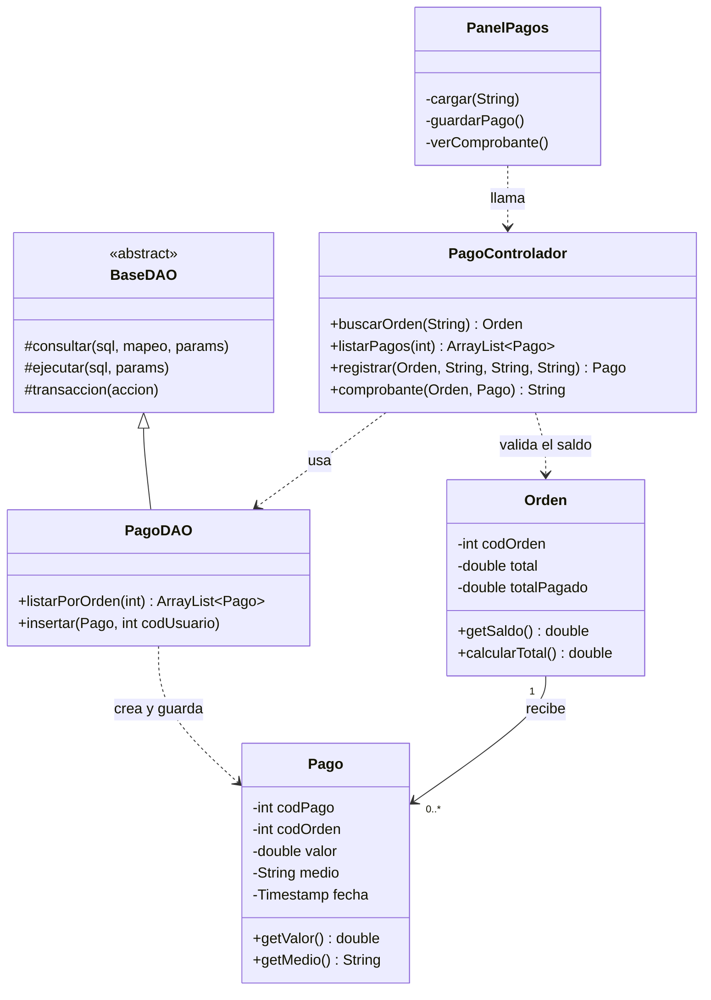

# Diagramas de referencia

## Diagrama de clases (flujo del módulo Pagos, de la vista a la base de datos)
Muestra cómo se encadenan las capas en un módulo completo: `PanelPagos` (Vista) → `PagoControlador` → `PagoDAO` → `Pago`/`Orden` (Modelo).

